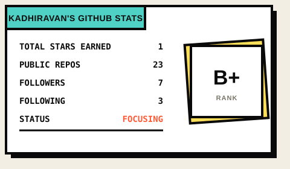
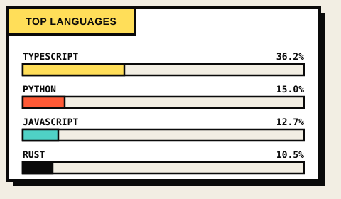

 

 

## [ WHOAMI ]

<table>
<tr>
<td width="60%" valign="top">

</td>
<td width="40%" valign="top">

**CURRENTLY**

`>` Building offensive-security tooling
`>` Practicing detection engineering
`>` Preparing for OSCP
`>` Bug hunting on HackerOne / Bugcrowd
`>` Pentesting, K8s hardening & DevSecOps

---

**ACTIVE PROJECTS**

`FLAMES` — gamified firewall/network security training platform
`cloudcompliance` — SOC2-ready AWS IaC baseline
`secure-kube` — CIS-aligned zero-trust Kubernetes via IaC
`Helmify` — CLI that generates production Helm charts
`nodewipe` — removes unwanted Node packages

</td>
</tr>
</table>

## [ WHAT I DO ]

<table width="100%">
<tr>
<td width="33%" align="center" valign="top">

**// OFFENSE**

Web & API pentesting, recon, exploit chaining, CTFs, bug bounty hunting.

</td>
<td width="33%" align="center" valign="top">

**// DEFENSE**

SIEM tuning, log correlation, threat hunting, container & K8s hardening.

</td>
<td width="33%" align="center" valign="top">

**// PLATFORM**

DevSecOps pipelines, IaC with Terraform, cloud security on AWS/GCP.

</td>
</tr>
</table>

## [ STACK ]

**LANGUAGES**

**SECURITY & OFFENSIVE TOOLS**

**CLOUD & DEVOPS**

**MONITORING & OBSERVABILITY**

**DATABASES & BACKEND**

## [ METRICS ]

  

<table align="center">
  <tr>
    <td>
      
    </td>
    <td>
      
    </td>
  </tr>
</table>

## [ CONTRIBUTIONS ]

<table align="center" width="100%">
<tr><td align="center" style="border:4px solid #0A0A0A;">

</td></tr>
</table>

## [ REACH ME ]

  
  
  
  
  
  

> *"THE QUIETER YOU BECOME, THE MORE YOU ARE ABLE TO HEAR."*

**JOKER53 · KADHIRAVAN E.G.**

