<div align="center">


</div>

<div align="center">

<a href="https://git.io/typing-svg"></a>

<br/>


</div>

<br/>

## 📇 Identity Card

<table>
<tr>
<td width="60%" valign="top">

```yaml
name:        Kadhiravan E.G.
alias:       JOKER53
role:        Cybersecurity Engineer & Ethical Hacker
education:   B.E. Cyber Security (Ongoing)
location:    Tamil Nadu, India
website:     joker53.me
email:       kadhiravanegk@gmail.com
mission:     "Turn every vulnerability into a lesson"
status:      🟢 open_to_opportunities
```

</td>
<td width="40%" valign="top">

**Currently**
- 🔭 Building offensive-security tooling
- 🛡️ Practicing detection engineering
- 🌱 Preparing for OSCP
- 🐛 Hunting on HackerOne / Bugcrowd
- 💬 Ask me about pentesting, K8s hardening, or DevSecOps

</td>
</tr>
</table>


## 🧩 What I Do

<table width="100%">
<tr>
<td width="33%" align="center" valign="top">

### 🗡️ Offense
Web & API pentesting, recon, exploit chaining, CTFs, bug bounty hunting.

</td>
<td width="33%" align="center" valign="top">

### 🛡️ Defense
SIEM tuning, log correlation, threat hunting, container & K8s hardening.

</td>
<td width="33%" align="center" valign="top">

### ☁️ Platform
DevSecOps pipelines, IaC with Terraform, cloud security on AWS/GCP.

</td>
</tr>
</table>


<div align="center" >

## Stack

### ◈ Languages


### ◈ Security & Offensive Tools


### ◈ Cloud & DevOps


### ◈ Monitoring & Observability


### ◈ Databases & Backend


</div>


## 📈 Skill Radar

<details>
<summary><b>Click to expand proficiency breakdown</b></summary>
<br/>

**Offensive Security**
```
Web App Pentesting     ████████▓░  90%
API Security Testing   ███████░░░  75%
Binary Exploitation    ██████░░░░  65%
Network Recon & OSINT  ████████░░  80%
Social Engineering     ██████▓░░░  70%
```

**Defensive Security**
```
SIEM & Log Analysis    ████████░░  80%
Container Hardening    ███████░░░  70%
Threat Hunting         ██████░░░░  65%
Cloud Security         ████████░░  80%
DevSecOps Pipelines    ███████░░░  75%
```

</details>


## 🏹 Bug Bounty & CTF

<div align="center">

<a href="https://tryhackme.com/r/p/JOKER53"></a>
<a href="https://hackthebox.com"></a>
<a href="https://hackerone.com"></a>
<a href="https://bugcrowd.com"></a>

</div>


## 📊 Metrics

<div align="center">

</div>

<div align="center">

</div>


## 📡 Reach Me

<div align="center">

<a href="http://joker53.me"></a>
<a href="https://github.com/KADHIRAVANEG"></a>
<a href="https://linkedin.com/in/kadhiravan-e-g-028818327"></a>
<a href="mailto:kadhiravanegk@gmail.com"></a>
<a href="https://instagram.com/__kadhiravan__"></a>
<a href="https://tryhackme.com/r/p/JOKER53"></a>

</div>


<div align="center">

> *"The quieter you become, the more you are able to hear."* — Kali Linux motto

**🔐 JOKER53 · Kadhiravan E.G. 🔐**

</div>
